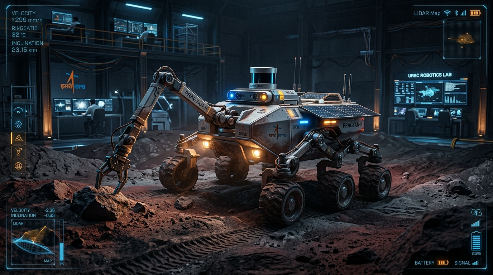
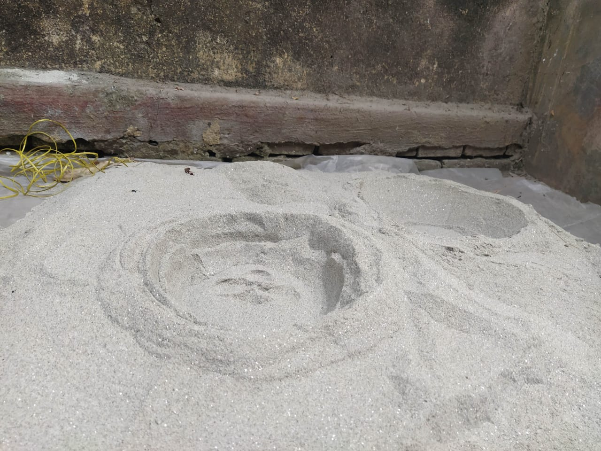
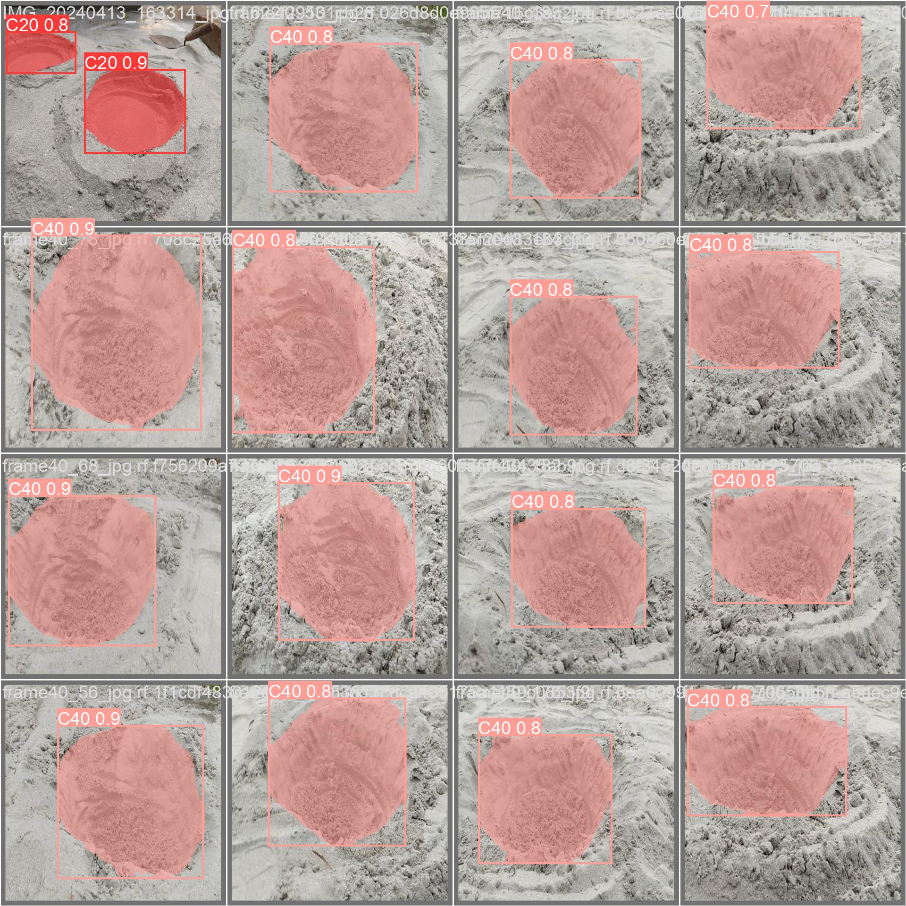
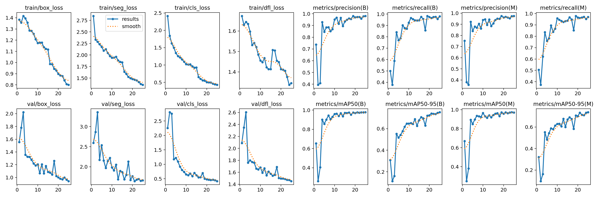
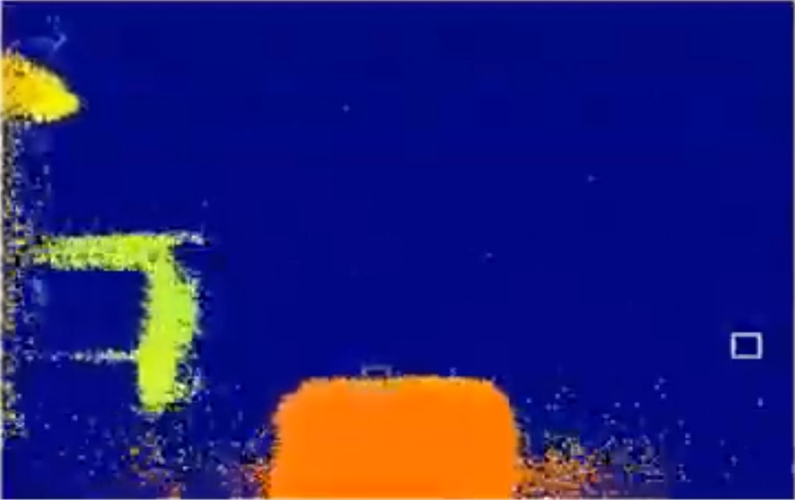
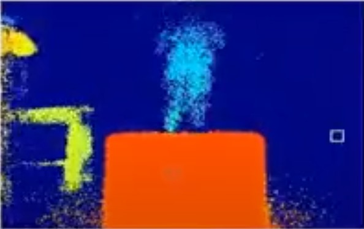
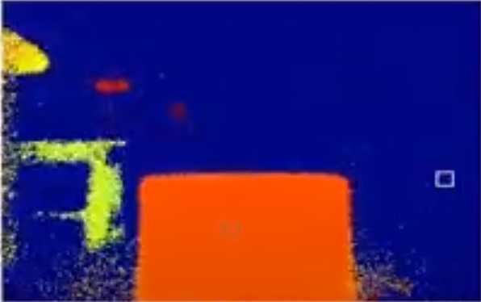

# Project OBSERACT: Autonomous Planetary Exploration Rover
### ISRO Robotics Challenge - URSC 2024 (IRoC-U 2024) | 5th Position Nationally



<div align="center">

[](#competition-overview--national-achievement)
[-blue?style=for-the-badge)](#team--mentorship)
[](#team--mentorship)

[](ISRO/arm_manipulator_C_Code/)
[](ISRO%20Total%20File/ISRO%20Robotics%20Challenge/autonomy/)
[](ISRO/stm_roboarm/)
[](ISRO%20Total%20File/ISRO%20Robotics%20Challenge/Jetson%20Orin/)
[](ISRO/stm_roboarm/src/main.cpp)
[](ISRO/ML/)
[](ISRO/General%20Codes/)
[](ISRO/stm_roboarm/platformio.ini)

</div>

---

## Table of Contents
1. [Competition Overview & National Achievement](#competition-overview--national-achievement)
2. [System Architecture & Dataflow](#system-architecture--dataflow)
3. [Core Engineering Features](#core-engineering-features)
4. [Computer Vision & Edge AI Pipeline](#computer-vision--edge-ai-pipeline)
5. [5-DOF Manipulator & Analytical Kinematics](#5-dof-manipulator--analytical-kinematics)
6. [Bill of Materials (BOM) & Pinout Configuration](#bill-of-materials-bom--pinout-configuration)
7. [Repository File & Directory Structure](#repository-file--directory-structure)
8. [Hardware & Software Setup Guide](#hardware--software-setup-guide)
9. [Media Showcase & Field Tests](#media-showcase--field-tests)
10. [Team & Mentorship](#team--mentorship)
11. [License & Acknowledgments](#license--acknowledgments)

---

## Competition Overview & National Achievement

The **ISRO Robotics Challenge - URSC 2024 (IRoC-U 2024)** was organized by the **U R Rao Satellite Centre (URSC), Indian Space Research Organisation (ISRO)**, Bengaluru. The challenge invited premier universities across India to engineer an extraterrestrial rover prototype capable of operating in simulated lunar and Martian regolith environments.

### Mission Criteria
- **Rocker-Bogie Traverse:** Traverse harsh uneven terrain, scale 150 mm & 300 mm obstacles, and negotiate 15° inclines at controlled speeds of 1 to 5 cm/s.
- **Crater Detection & Avoidance:** Identify and traverse or navigate around 20 cm and 40 cm diameter hemispherical craters.
- **Sample Manipulation:** Autonomously detect, grip, elevate, and deposit target sample cylinders using an onboard multi-axis robotic arm with closed-loop force sensing.
- **Beyond-Line-of-Sight Remote Operation:** Complete all operations remotely within a strict 40-minute window without direct line-of-sight, guided solely by real-time sensor fusion and video telemetry over a 5 GHz wireless link.
- **Emergency Protection:** Hardwired emergency kill-switch mechanism providing instantaneous actuator power isolation.

> **National Standing:** **Team OBSERACT (Team ID: 10487)** from **Jadavpur University, Kolkata** achieved **5th Position Nationally in India**, successfully passing stringent preliminary rounds, design qualification audits, and competitive arena trials.

---

## System Architecture & Dataflow

The rover utilizes a **hierarchical dual-tier processing architecture**: an NVIDIA Jetson Edge AI computer executes compute-heavy perception, neural inference, and path planning, while an STM32F407 ARM Cortex-M4 microcontroller executes deterministic, low-latency motor commutation, CAN bus bus-arbitration, and sensor acquisition.

```
===================================================================================================
                                      PROJECT OBSERACT SYSTEM ARCHITECTURE
===================================================================================================

 [ SENSORS & PERCEPTION ]
   * Arducam 3D ToF Depth Camera (MIPI-CSI) --------+
   * HD Optical Camera (USB / CSI) -----------------+
   * Adafruit BNO055 9-DOF IMU (I2C Bus 1) --------+
   * Gripper Piezoresistive FSR Force Sensor (ADC) -+---> [ NVIDIA JETSON ORIN / NANO ]
   * End-Effector Limit Switches (GPIO) ------------+     (Edge AI & Autonomous High-Level Brain)
                                                               |
                                                               |--- Ultralytics YOLOv8 Inference
                                                               |    (OB150, OB300, Sample, Craters)
                                                               |--- 3D Point Cloud & Depth Buffer Map
                                                               |--- Closed-Loop Heading / Waypoint Nav
                                                               |--- Analytical Inverse Kinematics (IK)
                                                               |
                     +-----------------------------------------+
                     | High-Level Movement Packets & Angle Targets
                     v (I2C Bus @ Addr 0x09 / UART Serial 115200)
       [ STM32F407VET6 ARM CORTEX-M4 MCU ]
       (Low-Level Deterministic Real-Time Controller)
         |
         |---> SPI Interface (PA15 CS) ---> [ MCP2515 CAN Controller ] ---> CAN 2.0B Bus (500 Kbps)
         |                                                                      |
         |                                                                      +---> [ CAN Nodes ]
         |---> Multi-Channel Bipolar Stepper Drivers --------------------------------+
         |     (Current-Limiting & Thermal Protection)                               |
         |                                                                           v
         +---> High-Torque 24V 54 kg-cm Planetary Steppers (x6) ----------> [ ROCKER-BOGIE CHASSIS ]
         |
         +---> 5-DOF Robotic Arm Actuators (Base, Shoulder, Elbow, Gripper)-> [ MANIPULATOR ARM ]

 [ TELEMETRY & BASE STATION ]
   [ Jetson Edge System ] <---> [ Ubiquiti 5GHz 23dBi LBE-M5-23 Link ] <---> [ BASE STATION GUI ]
                                 - Low-Latency Socket Video Streaming           - Telemetry Dashboard
                                 - JSON/Binary IMU & Pose Packets              - Real-Time Waypoint Map
===================================================================================================
```

---

## Core Engineering Features

- **6-Wheel Rocker-Bogie Suspension:**
  - Engineered with lightweight, structural aluminum T-slot framing (400 mm rocker, 160 mm bogie, 100° span angle).
  - Maintains continuous ground contact across all six wheels on extreme regolith gradients without mechanical springs.
  - Zero-radius differential turning allows on-the-spot rotation and tight steering in confined spaces.
- **Industrial Planetary Drive Actuation:**
  - Six independent 24V bipolar planetary geared stepper motors providing up to **54 kg-cm torque** per wheel.
  - Dedicated multi-channel drive PCB equipped with dynamic current limiting and thermal shutdown safeguards.
- **Dual-Bus Communication Hierarchy:**
  - **CAN Bus 2.0B @ 500 kbps:** Driven by STM32 via SPI-controlled Microchip MCP2515 transceiver for noise-immune actuator signaling.
  - **I2C Master/Slave Protocol:** Jetson Nano operates as I2C master sending motion primitives (`1: Forward`, `2: Backward`, `3: Left`, `4: Right`, `5: Stop`, `6: Heading Target`) to the microcontroller slave at address `0x09`.
- **Closed-Loop Heading Stabilization:**
  - Real-time absolute Euler orientation feedback sourced from the **Adafruit BNO055 9-DOF IMU**.
  - Dynamic turning algorithms (`turn_to_angle`) maintain trajectory accuracy within $\pm 1^\circ$ tolerance.
- **Edge-to-Ground High-Bandwidth Telemetry:**
  - Long-range directional Ubiquiti LiteBeam 5GHz antenna (23 dBi gain) running low-latency TCP/IP socket video streaming.
  - Custom serialization protocol packing frame headers (`struct.pack("Q", len(frame))`) for live ground control feeds.
- **Fail-Safe Emergency Cutoff:**
  - Integrated hardware kill-switch triggering direct power isolation to all actuator circuits within milliseconds.

---

## Computer Vision & Edge AI Pipeline

The vision pipeline is optimized for edge inference on NVIDIA Jetson GPUs using custom-trained Ultralytics YOLOv8 architectures.

```
Raw Camera Frame / Depth Stream
               │
               ▼
  ┌─────────────────────────┐
  │ Preprocessing & Resize  │
  └────────────┬────────────┘
               ├──────────────────────────────────────────┐
               ▼                                          ▼
  ┌───────────────────────────┐             ┌───────────────────────────┐
  │   Crater Detection Model  │             │ Obstacle & Target Model   │
  │   (YOLOv8 Nano/Small)     │             │ (YOLOv8 Custom)           │
  │   - 20 cm Craters         │             │ - OB150 (150 mm Cube)     │
  │   - 40 cm Craters         │             │ - OB300 (300 mm Cube)     │
  │   - 98% Test Accuracy     │             │ - SAMPLE (Collection Tube)│
  │   - LabelMe Annotated     │             │ - CONTAINER (Drop Zone)   │
  └────────────┬──────────────┘             └─────────────┬─────────────┘
               └────────────────────┬─────────────────────┘
                                    ▼
                      ┌───────────────────────────┐
                      │ Arducam ToF Depth Fusion  │
                      │ (Distance & Bearing XYZ)  │
                      └─────────────┬─────────────┘
                                    ▼
                      ┌───────────────────────────┐
                      │ Vector Field Obstacle     │
                      │ Avoidance & Waypoint Nav  │
                      └───────────────────────────┘
```

### Perception Highlights
1. **Crater Localization:** 500 images of simulated craters captured under varied arena lighting and annotated using LabelMe. Categorized into 20 cm and 40 cm classes, trained over 30 epochs, reaching **98% classification and localization accuracy**.
2. **ISRO Obstacle Detection:** Custom YOLOv8 model detecting competition markers: `OB150` (150 mm climbing block), `OB300` (300 mm avoidance block), and `SAMPLE` tube.
3. **Arducam Time-of-Flight (ToF) Spatial Mapping:** Generates real-time 4-meter depth buffers over MIPI-CSI, computing Euclidean distance and spatial angles to target objects.

---

## 5-DOF Manipulator & Analytical Kinematics

The rover carries a 5-Degree-of-Freedom robotic arm configured in a **TRRT** (Twist-Revolute-Revolute-Twist) kinematic arrangement built with lightweight CNC aluminum links and dual-bearing revolute joints.

### Denavit-Hartenberg (D-H) Parameter Table
| Link ($i$) | Joint Angle ($\theta_i$) | Link Offset ($d_i$) | Link Twist ($\alpha_i$) | Link Length ($a_i$) |
|:---:|:---:|:---:|:---:|:---:|
| **1** | $\theta_1$ | $0$ | $-90^\circ$ | $0$ |
| **2** | $\theta_2$ | $0$ | $0^\circ$ | $L_1$ ($228.39\text{ mm}$) |
| **3** | $\theta_3$ | $0$ | $0^\circ$ | $L_2$ ($248.00\text{ mm}$) |
| **4** | $\theta_4$ | $0$ | $+90^\circ$ | $0$ |
| **5** | $\theta_5$ | $0$ | $0^\circ$ | $0$ |

### Analytical Inverse Kinematics Formulation
Given target end-effector coordinates $(q_x, q_y, q_z)$ and orientation matrix elements $r_{ij}$:

$$\theta_1 = \text{atan2}(q_y, q_x)$$

$$\theta_3 = \arccos\left(\frac{q_x^2 + q_y^2 + q_z^2 - L_1^2 - L_2^2}{2 L_1 L_2}\right)$$

$$\theta_2 = \arctan\left(\frac{L_1 + L_2 \cos\theta_3}{L_2 \sin\theta_3}\right) + \arctan\left(\frac{q_x \cos\theta_1 + q_y \sin\theta_1}{-q_z}\right)$$

$$\theta_4 = \arctan\left(\frac{r_{13} \cos\theta_1 + r_{23} \sin\theta_1}{r_{33}}\right) - \theta_2 - \theta_3$$

$$\theta_5 = \arctan\left(\frac{r_{21} \cos\theta_1 - r_{11} \sin\theta_1}{r_{22} \cos\theta_1 - r_{21} \sin\theta_1}\right)$$

*Closed-form solutions are implemented in high-performance C/C++ ([`arm_manipulator_C_Code.ino`](ISRO/arm_manipulator_C_Code/arm_manipulator_C_Code.ino)) and Python for real-time trajectory planning.*

---

## Bill of Materials (BOM) & Pinout Configuration

### Master Bill of Materials (BOM)
| Subsystem | Component Description | Specifications / Model | Qty | Function |
|:---|:---|:---|:---:|:---|
| **Chassis** | Rocker-Bogie Linkage | 6061-T6 Aluminum T-Slots | 1 Set | Terrain articulation & ground clearance |
| **Locomotion** | Planetary Geared Stepper | 24V, 54 kg-cm torque, BH42SH38-1684PL | 6 | Individual wheel traction & drive |
| **Wheels** | Custom Regolith Wheels | High-durability Nylon / Rubber treads | 6 | Regolith surface grip |
| **Drive Electronics** | Stepper Driver Controller | Multi-Channel Current Regulated Board | 1 | Microstepping & current limiting |
| **Embedded Compute** | Microcontroller | STM32F407VET6 (ARM Cortex-M4, 168 MHz) | 1 | Real-time motion control & CAN bus |
| **Edge AI Brain** | Edge AI Computer | NVIDIA Jetson Nano / Jetson Orin | 1 | YOLOv8 inference, CV, high-level nav |
| **CAN Bus Interface** | CAN Controller & PHY | Microchip MCP2515 + TJA1050 | 1 | High-speed SPI-to-CAN 2.0B bus |
| **Attitude Sensor** | 9-DOF Absolute IMU | Adafruit BNO055 | 1 | Orientation, angular rate & heading |
| **Depth Sensor** | Time-of-Flight Camera | Arducam ToF Depth Camera (MIPI-CSI) | 1 | 3D obstacle depth mapping (up to 4m) |
| **Robotic Arm** | 5-DOF Manipulator | Precision Steppers + Digital High-Torque Servos | 5 | Sample pickup, elevation, and drop |
| **End Effector** | Force Feedback Sensor | Piezoresistive FSR (Analog 0-1023) | 1 | Grasping force regulation |
| **End Effector** | Limit Switches | Microswitches | 2 | Mechanical over-travel protection |
| **RF Communications** | Directional Long-Range Antenna| Ubiquiti LiteBeam LBE-M5-23 (5 GHz, 23 dBi)| 2 | Low-latency telemetry link (Rover + Base) |
| **Power Storage** | Main Battery Pack | 24V High-Discharge Lithium-Ion Pack | 1 | System master power source |
| **Power Distribution** | Custom PDB | Buck Converters (24V $\to$ 12V, 5V, 3.3V) + XT60 | 1 | Regulated rails & noise filtering |
| **Safety System** | Emergency Kill Switch | High-Current Latching E-Stop Switch | 1 | Instantaneous actuator power cut |

### GPIO Pinout & Communication Interconnect Map

| Device / Module | Signal / Pin | Host / Board Connection | Protocol / Logic Level | Description |
|:---|:---|:---|:---|:---|
| **MCP2515 CAN** | `CS` | STM32F407 Pin `PA15` | SPI (3.3V) | Chip Select for CAN Bus Controller |
| **MCP2515 CAN** | `SCK` | STM32F407 Pin `PB3` / `PA5` | SPI Clock | SPI Bus Clock Line |
| **MCP2515 CAN** | `SO / MISO`| STM32F407 Pin `PB4` / `PA6` | SPI MISO | Controller Data In |
| **MCP2515 CAN** | `SI / MOSI`| STM32F407 Pin `PB5` / `PA7` | SPI MOSI | Controller Data Out |
| **MCP2515 CAN** | `INT` | STM32F407 Interrupt GPIO | Active-Low Interrupt | Frame Receive Notification |
| **BNO055 9-DOF IMU**| `SDA` | Jetson Pin 3 / STM32 `PB7` | I2C (3.3V Pull-up) | Serial Data Line |
| **BNO055 9-DOF IMU**| `SCL` | Jetson Pin 5 / STM32 `PB6` | I2C (3.3V Pull-up) | Serial Clock Line |
| **MCU Slave Port** | `SDA / SCL`| Jetson I2C Bus 1 $\to$ MCU Addr `0x09`| I2C (3.3V) | Motion command link (Jetson $\to$ MCU) |
| **Gripper FSR** | `V_OUT` | STM32 ADC Channel `A0` | Analog (0 - 3.3V) | Force mapping ($0 - 100\%$) |
| **Gripper Limit SW**| `SIGNAL` | STM32 Digital GPIO (Pull-up) | Digital Input | Stroke limit safety interlock |
| **Arducam Depth Cam**| `CSI-2` | Jetson 15-pin / 22-pin MIPI Port | High-Speed MIPI-CSI | Real-time ToF raw depth stream |
| **Kill Switch** | `V_IN / V_OUT`| In-line with 24V Drive Rail | High-Current DC | Emergency power cutoff to drivers |

---

## Repository File & Directory Structure

```
IRoCU-2024/
├── assets/
│   ├── banner.png                              # High-tech project banner
│   ├── photos/                                 # Hardware and arena prototype photos
│   │   ├── crater_detection_yolov8.jpeg        # YOLOv8 crater inference validation
│   │   ├── crater_training_metrics.png         # Precision-recall & loss curves
│   │   ├── rover_hardware_prototype.jpg        # Fabricated Rocker-Bogie chassis
│   │   ├── obstacle_150mm_cube.jpg             # 150mm obstacle detection target
│   │   ├── obstacle_300mm_cube.jpg             # 300mm obstacle avoidance target
│   │   └── obstacle_sample_tube.jpg            # Cylindrical sample target
│   └── videos/                                 # Field tests & mobility recordings
│       ├── rover_mobility_demo.mp4             # 6-wheel rover traversal test
│       ├── obstacle_traversal_demo.mp4         # Rocker-bogie climbing demonstration
│       └── robotic_arm_demo.mp4                # Manipulator pick-and-place trial
├── ISRO/
│   ├── ArmManipulatorC_code_2/                 # Manipulator kinematics firmware
│   ├── arm_manipulator_C_Code/                 # 5-DOF analytical IK implementation
│   ├── Client Server/                          # Video & telemetry socket streaming
│   ├── Force_Sensor_Code/                      # FSR analog force measurement code
│   ├── General Codes/                          # Vector math, frame extraction & nav
│   ├── ML/                                     # YOLOv8 crater weights (best_25.pt)
│   ├── stm_roboarm/                            # PlatformIO project for STM32F407VE
│   │   ├── platformio.ini                      # STSTM32 platform config & DFRobot CAN
│   │   └── src/main.cpp                        # CAN bus transmission loop
│   └── New folder/                             # Design report, schematics & rulebooks
├── ISRO Total File/
│   ├── ISRO Robotics Challenge/
│   │   ├── autonomy/                           # Integrated YOLOv8 + I2C heading navigation
│   │   │   ├── autonomy.py                     # Main autonomy control loop
│   │   │   ├── heading_i2c.py                  # BNO055 IMU + I2C MCU arbitration
│   │   │   └── ml-inf.py                       # Standalone edge inference
│   │   ├── obseract-live-demonstration/        # Arducam ToF depth camera integration
│   │   │   └── depth_cam.py                    # ToF 3D spatial colormapping & range
│   │   └── obseract/                           # Inverse kinematics regression models
│   ├── New Designs/                            # SolidWorks CAD assemblies (.SLDASM, .SLDPRT)
│   └── OBS_Chassis/                            # Rocker-Bogie chassis structural models
├── .gitignore                                  # Optimized Git exclusion filters
└── README.md                                   # Production project documentation
```

---

## Hardware & Software Setup Guide

### 1. Embedded Firmware Setup (STM32F407VE)

The low-level controller firmware is developed using **PlatformIO** and **STM32CubeIDE**.

```bash
# Clone the repository
git clone https://github.com/<your-username>/IRoCU-2024.git
cd IRoCU-2024/ISRO/stm_roboarm

# Install PlatformIO Core if not installed:
pip install platformio

# Compile firmware for STM32F407VE
pio run -e black_f407ve

# Flash to target board via ST-Link v2
pio run -e black_f407ve --target upload
```

### 2. Jetson Edge AI & Autonomous Navigation Setup

Ensure your NVIDIA Jetson Nano / Orin is flashed with **JetPack 5.x / Ubuntu 20.04+** with CUDA and TensorRT enabled.

```bash
# Navigate to the autonomy module
cd "ISRO Total File/ISRO Robotics Challenge/autonomy"

# Create virtual environment
python3 -m venv venv
source venv/bin/activate

# Install required packages
pip install --upgrade pip
pip install ultralytics opencv-python numpy smbus2 adafruit-circuitpython-bno055

# Run the autonomous perception and drive loop
python3 autonomy.py
```

### 3. Video Telemetry & Ground Station Streaming

**On Rover (NVIDIA Jetson Server):**
```bash
cd "ISRO/Client Server/Socket Programming Video streaming"
python3 Server.py
```

**On Ground Control Station (PC Client):**
```bash
cd "ISRO Total File/ISRO Robotics Challenge/obseract-live-demonstration"
python3 client.py --host <ROVER_IP_ADDRESS> --port 9999
```

---

## Media Showcase & Field Tests

### Hardware Prototype & Deep Learning Outputs
| Fabricated Rover Prototype | YOLOv8 Crater Detection | Model Metrics |
|:---:|:---:|:---:|
|  |  |  |
| *6-wheel Rocker-Bogie suspension testbed* | *Real-time 20cm/40cm crater inference* | *High precision-recall curve ($98\%$)* |

### Field Target Markers
| 150 mm Obstacle Block | 300 mm Obstacle Block | Sample Retrieval Tube |
|:---:|:---:|:---:|
|  |  |  |
| *Scaling & traversal target* | *Autonomous avoidance obstacle* | *5-DOF manipulator pickup target* |

### Demonstration Video Recordings
Demonstration video files are located in [`assets/videos/`](assets/videos/):
- **Locomotion Traverse:** [`rover_mobility_demo.mp4`](assets/videos/rover_mobility_demo.mp4) — Demonstrates 6-wheel differential traction across uneven terrain.
- **Obstacle Clearance:** [`obstacle_traversal_demo.mp4`](assets/videos/obstacle_traversal_demo.mp4) — High-clearance rocker-bogie traversing obstacles without chassis tilting.
- **Sample Manipulation:** [`robotic_arm_demo.mp4`](assets/videos/robotic_arm_demo.mp4) — Precision sample grasping with real-time FSR force feedback.

---

## Team & Mentorship

<div align="center">

### Faculty Mentors
**Prof. Dr. Sayan Chatterjee**  
*Professor, Department of Electronics & Telecommunication Engineering*  
*Jadavpur University, Kolkata*

**Prof. Dipankar Sanyal**  
*Professor, Department of Mechanical Engineering*  
*Jadavpur University, Kolkata*

---

### Student Engineering Team (Team OBSERACT)

| # | Name | Department | Role / Subsystem Specialization |
|:---:|:---|:---|:---|
| 1 | **Samim Akhtar** | Electronics & Telecommunication Engg | **Team Lead** · Embedded Architecture, CAN Bus & Vision Integration |
| 2 | **Priyabrata Basu** | Electronics & Telecommunication Engg | Telecommunications, Socket Networking & RF Telemetry |
| 3 | **Diptanshu Chakrabartty**| Civil Engineering | Structural Loading, Dynamics & Ground Analysis |
| 4 | **Saptarshi Maity** | Metallurgical & Material Engineering | Materials Selection, Thermal Profiling & Link Rigidity |
| 5 | **Asfak Ali** | Electronics & Telecommunication Engg | Low-Level Firmware, STM32 Driver Development & Kinematics |
| 6 | **Sanjay Thakur** | Electrical Engineering | Power Distribution Board (PDB), Motor Drivers & Battery |
| 7 | **Hrishitava Sarkar** | Mechanical Engineering | Rocker-Bogie Chassis Design, SolidWorks CAD & Stress FEA |
| 8 | **Sayan Kumar Sah** | Metallurgical & Material Engineering | Fabrication, Joint Machining & Mechanical Prototyping |
| 9 | **Mainak Dey** | Mechanical Engineering | 5-DOF Robotic Arm Mechanical Design & Gripper Mechanism |
| 10 | **Animesh Majumder** | Metallurgical & Material Engineering | Chassis Testing, Quality Assurance & Mechanical Assembly |

</div>

---

## License & Acknowledgments

- **Competition Host:** We express our deepest gratitude to the **U R Rao Satellite Centre (URSC), Indian Space Research Organisation (ISRO)** for conceptualizing and organizing the **IRoC-U 2024** challenge and providing a national platform for robotics innovation.
- **Academic Support:** Sincere thanks to **Jadavpur University**, the Department of Electronics & Telecommunication Engineering, and the Department of Mechanical Engineering for workshop facilities, fabrication resources, and departmental guidance.
- **License:** This project is distributed under the [MIT License](LICENSE).
